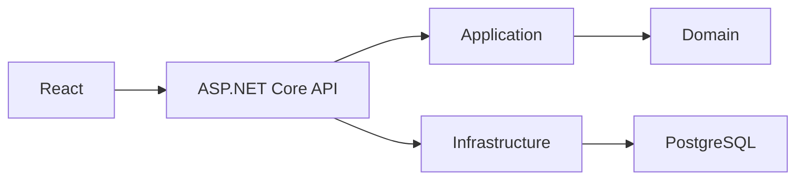

# Architecture

`flower-shop/` contains React 19, TypeScript, Vite, state management and localization. `flower-shop-backend/` contains ASP.NET Core API, application/domain layers, EF Core persistence and migrations. `OrderService` calculates prices within a transaction; `PricingService` applies promo and loyalty rules. Do not assume client totals are authoritative. The SMS abstraction currently has a mock provider and an unimplemented Eskiz class.
